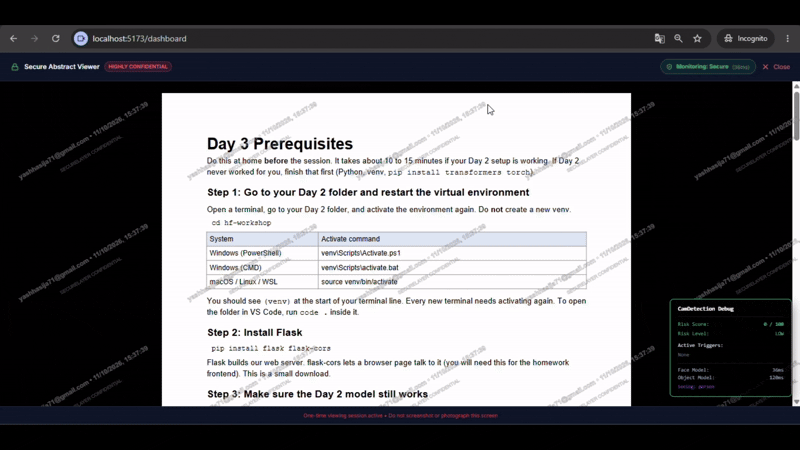
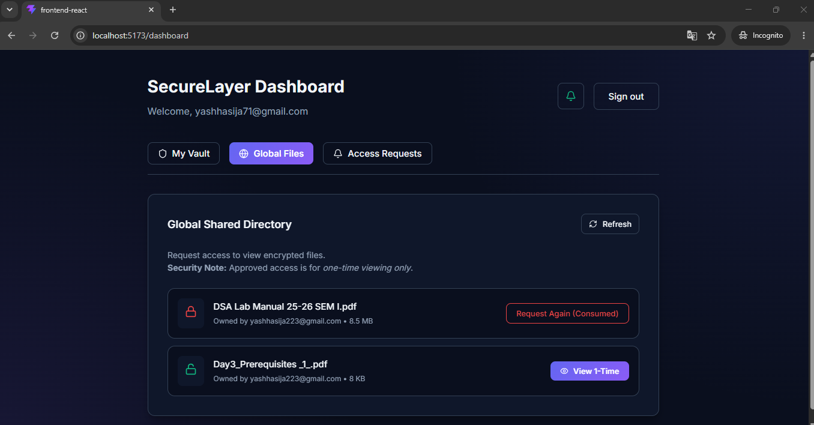
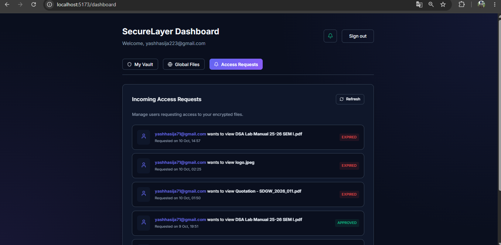
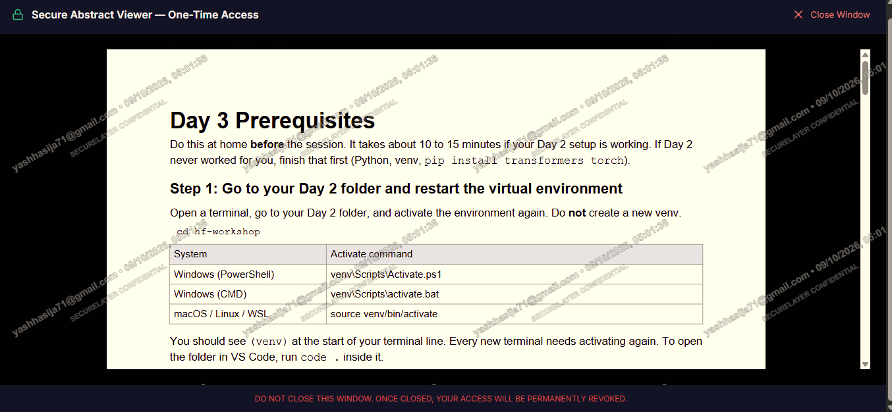
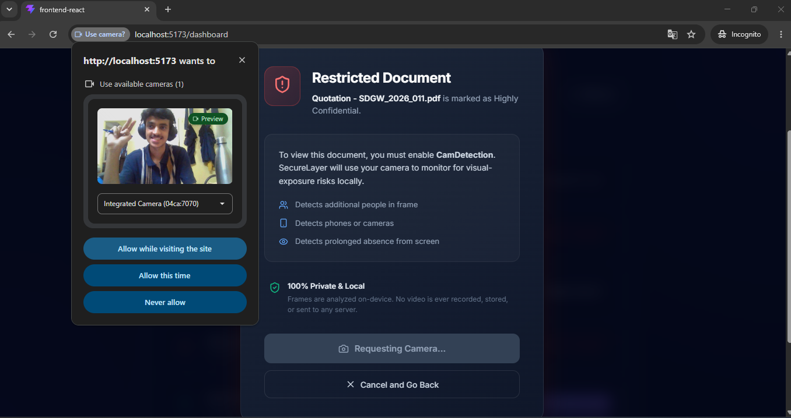
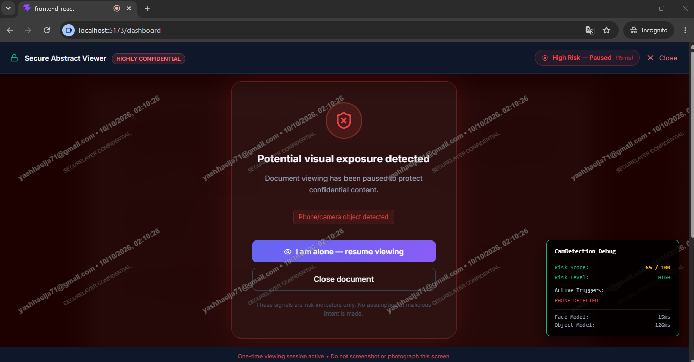
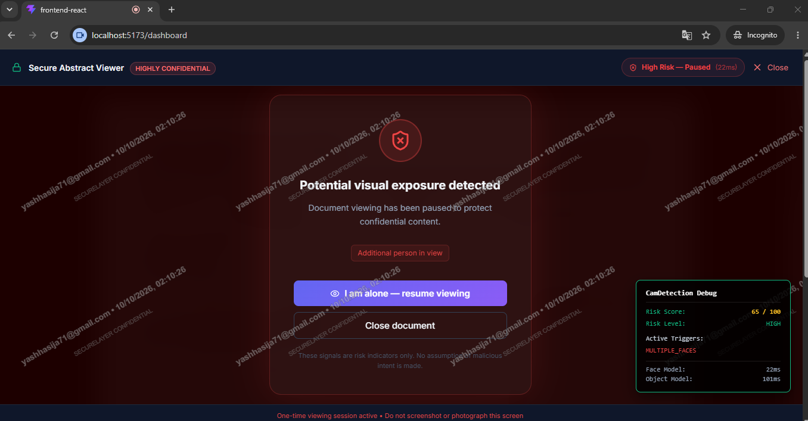
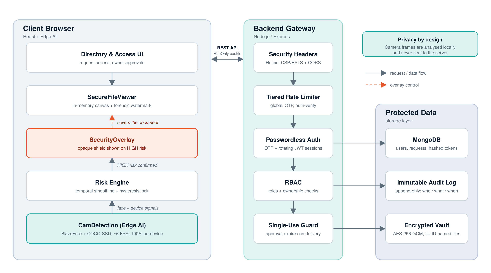
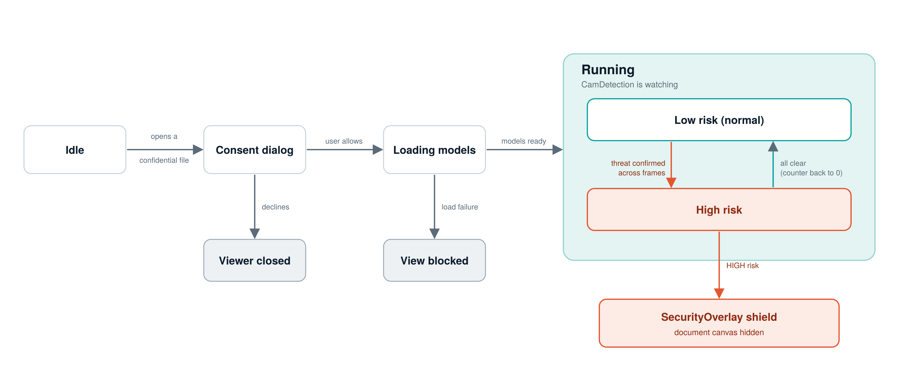

<div align="center">

# 🛡️ SecureLayer

**A zero-trust, privacy-first platform that protects confidential documents even while they are being read.**


[Demo video](#-demo) · [Features](#-features) · [Architecture](#-architecture) · [Quick start](#-quick-start) · [Security](#-security-model) · [Docs](#-documentation)

<!-- HERO: replace with a short GIF of CamDetection shielding the screen when a phone appears -->


</div>

---

## 🎯 Why SecureLayer?

Most sharing systems stop protecting a file the moment it is opened. After that, nothing prevents someone from photographing the screen, reading over a shoulder, walking away from an open document, or replaying a shared link.

SecureLayer closes that gap. Access is **one-time and owner-approved**, the document is **rendered in memory only**, every page carries a **forensic watermark**, and an **on-device AI guard** watches the physical environment and hides the document the moment a threat appears.

> **Privacy first:** all camera analysis runs locally in the browser. No frames, video or facial templates ever leave the device.

---

## ✨ Features

| Pillar | What it does |
| :--- | :--- |
| 🔑 **Access & Single-Use Allowance** | Files are discoverable but unreadable until the owner approves. Each approval is consumed on first delivery; replays return `403`. |
| 📄 **Secure File Viewer** | In-memory canvas rendering, text and annotation layers disabled, no disk or cache copy, blocked copy / print / save / right-click, forensic watermark. |
| 👁️ **CamDetection (Edge AI)** | Detects phones, extra onlookers and user absence for `HIGHLY_CONFIDENTIAL` files, then shields the screen instantly. |
| 🧱 **Hardened Backend** | Passwordless OTP login, rotating tokens, tiered rate limiting, AES-256-GCM encrypted storage, immutable audit log. |

### At a glance

| Spec | Value |
| :--- | :--- |
| Face detection | MediaPipe BlazeFace (short-range), ~6 FPS |
| Object / device detection | TensorFlow.js COCO-SSD (`lite_mobilenet_v2`), ~6 FPS |
| Threat triggers | Phone ~300 ms · Multiple faces ~450 ms · Face absent ~1.2 s |
| File encryption | AES-256-GCM, unique 12-byte IV and 16-byte auth tag per file |
| Login | Passwordless email OTP (6 digits, 5-minute expiry, 5 attempts max) |
| Sessions | Access JWT 15 min (in memory) · Refresh token 7 days (HttpOnly cookie, rotated on every use) |
| Rate limits | Global 100 req / 15 min / IP · OTP 3 / hour / email · Auth verify 20 / 15 min / IP |
| Uploads | Up to 10 MB per file (configurable) |

---

## 📸 Screenshots

<!-- Replace each placeholder image with a real screenshot saved in docs/images -->

| Global Directory | Owner Approval Inbox |
| :---: | :---: |
|  |  |

| Secure Viewer + Watermark | Camera Consent |
| :---: | :---: |
|  |  |

| Shield: Phone Detected | Shield: Multiple Faces |
| :---: | :---: |
|  |  |

---

## 🏗️ Architecture

<div align="center">
  
</div>

### CamDetection flow

<div align="center">
  
</div>

---

## 🚀 Quick Start

### Prerequisites

- Node.js **22 or newer**
- MongoDB (local or Atlas)
- A webcam (for `HIGHLY_CONFIDENTIAL` files)
- An SMTP account for sending OTP and notification emails (Nodemailer)

### 1. Clone

```bash
git clone https://github.com/yashhasiaj71/SecureLayer.git
cd SecureLayer
```

### 2. Configure the backend environment

Copy the example file and fill in your values. Never commit the real `.env`.

```bash
cp .env.example .env
```

| Variable | Default | Description |
| :--- | :--- | :--- |
| `PORT` | `5000` | API server port |
| `NODE_ENV` | `development` | Runtime environment |
| `MONGODB_URI` | _(required)_ | MongoDB connection string |
| `JWT_SECRET` | _(required)_ | Secret used to sign access tokens |
| `JWT_ACCESS_EXPIRES_IN` | `15m` | Access token lifetime |
| `JWT_REFRESH_EXPIRES_IN` | `7d` | Refresh token lifetime |
| `SMTP_HOST` | _(required)_ | SMTP server host |
| `SMTP_PORT` | `587` | SMTP server port |
| `SMTP_SECURE` | `false` | Use TLS from connection start (typically `true` for port 465) |
| `SMTP_USER` / `SMTP_PASSWORD` | _(required)_ | SMTP credentials |
| `SMTP_FROM` | _(required)_ | Sender address for outgoing mail |
| `AES_MASTER_KEY` | _(required)_ | 64 hex characters (256-bit key) for file encryption |
| `FRONTEND_URL` | `http://localhost:5173` | Allowed CORS origin (Vite default port) |
| `RATE_LIMIT_WINDOW_MS` | `900000` | Global rate-limit window (15 minutes) |
| `RATE_LIMIT_MAX` | `100` | Max requests per window per IP |
| `OTP_RATE_LIMIT_MAX` | `3` | Max OTP requests per hour per email |
| `OTP_EXPIRY_MINUTES` | `5` | OTP validity |
| `OTP_MAX_ATTEMPTS` | `5` | Verification attempts before the OTP is deleted |
| `MAX_FILE_SIZE_MB` | `10` | Maximum upload size |

Generate the master key:

```bash
node -e "console.log(require('crypto').randomBytes(32).toString('hex'))"
```

### 3. Install and run

Run these in the backend folder, then again in the frontend folder (separate terminals):

```bash
npm install
npm run dev
```

The API runs on **http://localhost:5000** and the app on **http://localhost:5173**.

---

## 🔐 Security Model

| Threat | Defence |
| :--- | :--- |
| Screen photography | CamDetection phone detection with persistence filtering, opaque shield |
| Shoulder surfing | Multi-face detection across consecutive frames |
| Unattended screen | Face-absence detection hides content |
| Copy / print / save | In-memory canvas viewer, blocked shortcuts and context menu |
| Leaks via external camera | Forensic watermark (viewer email + timestamp) |
| Replay / shared links | Single-use approval expires on first stream |
| Data at rest | AES-256-GCM with per-file IV and auth tag |
| Credential attacks | Passwordless OTP, bcrypt-hashed, 5-minute TTL |
| Session theft | In-memory JWT, rotating HttpOnly SameSite=Strict refresh cookie |
| Brute force / DoS | Global, OTP and auth-verify rate limiters |

**Design note:** browser-level controls are deterrents, not absolute guarantees. SecureLayer layers camera-based detection, watermark attribution and single-use access so no single control is relied on alone.

**Reporting a vulnerability:** please email [yashhasija71@gmail.com](mailto:yashhasija71@gmail.com) privately instead of opening a public issue.

---

## 📚 Documentation

- 📘 [Technical Report](docs/SecureLayer_Technical_Report.pdf)
- 🎤 [Project Presentation](docs/SecureLayer_Presentation.pdf)

## 🎬 Demo

<!-- Replace with your video link -->
[](https://youtu.be/your-video-id)

## 🗺️ Roadmap

- [ ] Fine-tuned recording-device detector for phone-at-screen imagery
- [ ] Head-pose / gaze estimation to confirm a second face is actually reading
- [ ] Per-file data keys with managed key rotation
- [ ] Time-boxed and view-count access policies
- [ ] Admin dashboard for audit analytics and anomaly alerts

## 🛠️ Built With

React · Vite · react-pdf · MediaPipe Tasks Vision · TensorFlow.js · COCO-SSD · Node.js · Express · MongoDB · Nodemailer · Helmet · bcrypt · JSON Web Tokens

## 🤝 Contributing

Contributions are welcome. Please open an issue to discuss a change first, and use conventional commit messages (`feat:`, `fix:`, `docs:`).

## 👤 Author

**Yash Hasija**
[GitHub](https://github.com/yashhasiaj71) · [LinkedIn](https://www.linkedin.com/in/yash-hasija-dev71) · [Email](mailto:yashhasija71@gmail.com)

<div align="center">

*Protection that follows the document into the room.*

</div>